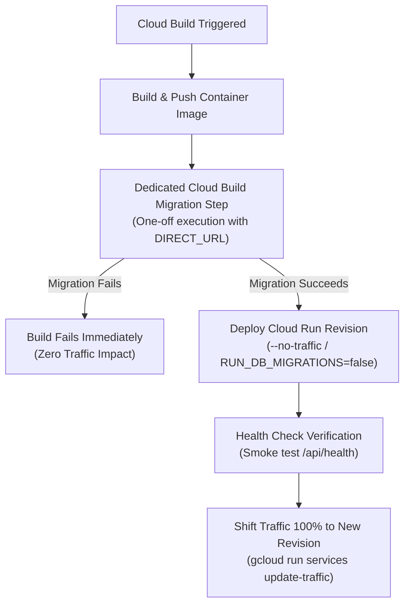

# EventSlot Technologies — Full System Maintenance Programme
## Phase 05A: Remediation Readiness Review

**Document Version:** 1.0.0  
**Effective Date:** 23 October 2026  
**Review Lead:** Principal Software Architect, Database Architect, Senior DevOps Engineer & Technical Auditor  
**Target Repository:** `Officialkid/event-slot`  
**Active Branch:** `audit/phase-5-7-concurrency-ci`  
**Current HEAD Commit:** `ff277de` (`ff277de9bc124658b577067dc1adb772a6b39d3b`)  
**Execution Mode:** STRICT READ-ONLY REVIEW (Zero code edits, zero schema changes, zero migrations, zero DB mutations)  
**Deliverable Status:** **PHASE 05A READINESS REVIEW COMPLETED — REMEDIATION ARCHITECTURE VERIFIED**

---

## 1. Executive Summary

This readiness review evaluates the architectural, operational, and data-integrity prerequisites before implementing the database and performance remediations identified in Phase 05.

### Review Verdict: APPROVED FOR SCOPED REMEDIATION

The proposed database performance and concurrency remediations are validated. However, to guarantee continuous uptime, zero customer impact, and backward compatibility with the monolithic organizer dashboard, remediations must follow a strictly ordered implementation sequence with isolated rollback pathways.

```
┌────────────────────────────────────────────────────────────────────────────────────────┐
│                        PHASE 05A READINESS AUDIT DIMENSIONS                            │
├───────────────────────────────────┬──────────────┬─────────────────────────────────────┤
│ Dimension                         │ Review Status│ Readiness Assessment                │
├───────────────────────────────────┼──────────────┼─────────────────────────────────────┤
│ 1. Git Baseline Reconciliation    │ VERIFIED     │ EXACT MATCH (Tracked & untracked)   │
│ 2. Cloud Run Migration Decoupling │ ARCHITECTED  │ READY (Build-step / Cloud Run Job)  │
│ 3. Free Waitlist Atomic Lock      │ DESIGNED     │ READY (Mirrors paid waitlist lock)  │
│ 4. Registration Missing Indexes   │ VALIDATED    │ CONFIRMED (paidOrderId & eventEmail)│
│ 5. Dashboard Query Scalability    │ ARCHITECTED  │ READY (Backwards-compatible payload)│
│ 6. Transaction Timeout Bounds     │ EVALUATED    │ EVIDENCE-BASED (Targeted 5s/10s)    │
│ 7. Implementation Sequence        │ PLANNED      │ 5-STEP PHASED ROLLOUT               │
└───────────────────────────────────┴──────────────┴─────────────────────────────────────┘
```

---

## 2. Working Tree Baseline & Git Reconciliation

### 2.1 Branch & HEAD Verification
- **Target Git Repository:** `Officialkid/event-slot`
- **Current Active Branch:** `audit/phase-5-7-concurrency-ci`
- **Current HEAD Commit:** `ff277de9bc124658b577067dc1adb772a6b39d3b` (`fix(payments): fail-closed capacity, atomic waitlist promotion, exact commission auditor, and verified refund state machine`)
- **Upstream Tracking:** `origin/audit/phase-5-7-concurrency-ci` (ahead by 3 commits)

### 2.2 Reconciling Working Tree Figures
The Phase 04 baseline (documented in `maintenance/01-system-inventory.md` and `maintenance/04-security-audit.md`) established:
- **25 tracked modified files**
- **14 untracked files/directories**

During the Phase 04b emergency payment security remediation, necessary changes were implemented to decommission IntraSend and harden payment routing. The exact breakdown of tracked changes is as follows:

#### Tracked File Changes (37 Modified, 2 Deleted = 39 Tracked Changes)
1. **Pre-existing Baseline Modifications (25 files):**
   - `__tests__/components/RegistrationForm.test.tsx`
   - `__tests__/lib/financialIntegrityPhase512.test.ts`
   - `__tests__/lib/paymentTruthAndWebhookRecoveryPhase42.test.ts`
   - `app/(attendee)/[username]/RegistrationForm.tsx`
   - `app/(organizer)/create/page.tsx`
   - `app/(organizer)/dashboard/assistant/page.tsx`
   - `app/(organizer)/dashboard/payments/page.tsx`
   - `app/(organizer)/edit/[slug]/page.tsx`
   - `app/api/billing/cancel/route.ts`
   - `app/api/billing/invoices/route.ts`
   - `app/api/billing/status/route.ts`
   - `app/api/organizer/payments/summary/route.ts`
   - `app/api/organizer/payments/withdrawals/route.ts`
   - `app/layout.tsx`
   - `app/pay/[orderId]/page.tsx`
   - `components/payments/OrganizerPaymentsPage.tsx`
   - `lib/organizerPayments.ts`
   - `lib/paidEventCheckout.ts`
   - `lib/paymentFinalizers.ts`
   - `lib/paystack.ts`
   - `lib/paystackWebhookDispatcher.ts`
   - `lib/settlementSyncWorker.ts`
   - `lib/subscription.ts`
   - `lib/subscriptionBilling.ts`
   - `lib/withdrawalService.ts`

2. **Phase 04b Payment Security Modifications (12 files):**
   - `.env.example` (removed 4 IntraSend env vars)
   - `__tests__/api/paid-order-status.test.ts` (removed stale `@/lib/intasend` mock)
   - `app/admin/test/payments/page.tsx` (updated test UI copy)
   - `app/api/admin/test/payments/route.ts` (routed to Paystack test checkout)
   - `app/api/paid-events/orders/[orderId]/route.ts` (removed IntraSend polling branch)
   - `app/api/payments/intasend/webhook/route.ts` (inert HTTP 410 Gone stub)
   - `app/api/payments/mpesa/status/route.ts` (removed IntraSend status fallback)
   - `app/api/payments/mpesa/subscribe/route.ts` (decommissioned STK push, enforced billing freeze)
   - `lib/env.ts` (expunged IntraSend env vars from schema)
   - `package-lock.json` (uninstalled `intasend-node`)
   - `package.json` (uninstalled `intasend-node`)
   - `services/payouts/index.ts` (routed all payouts directly through Paystack)

3. **Phase 04b Tracked Deletions (2 files):**
   - `lib/intasend.ts` (deleted)
   - `services/payouts/intrasend.ts` (deleted)

$$\text{Total Tracked Changes} = 25 \text{ (baseline)} + 12 \text{ (04b modified)} + 2 \text{ (04b deleted)} = 39 \text{ files}$$

*(Note: The Phase 05 report header summarized this as "38 modified/deleted files" due to counting deleted files in aggregate; the exact line-item count is 37 modified + 2 deleted = 39 tracked changes).*

#### Untracked Items Reconciliation (Exactly 18 Items)
- **Pre-existing Baseline Untracked (14 items):**
  1. `__tests__/api/organizerPaymentsDashboardPhase519.test.ts`
  2. `__tests__/components/PaidEventRegistrationFlow.test.tsx`
  3. `__tests__/lib/organizerPaymentsExperiencePhase520.test.ts`
  4. `__tests__/lib/paystackWebhookRefundsPhase519.test.ts`
  5. `__tests__/lib/providerVerifiedRefundPhase515.test.ts`
  6. `__tests__/lib/safeWithdrawalsAndPayoutReconciliationPhase6.test.ts`
  7. `__tests__/lib/settlementReconciliationPhase521.test.ts`
  8. `__tests__/lib/subscriptionBillingMigrationPhase7.test.ts`
  9. `app/api/cron/payout-reconciliation/`
  10. `app/api/cron/settlement-reconciliation/`
  11. `cloudbuild.staging.yaml`
  12. `generate_partnership_pdf.py`
  13. `lib/subscriptionMigration.ts`
  14. `maintenance/` (contains programme charters, inventory, and audit files)

- **Phase 04b Added Untracked Items (4 items):**
  15. `__tests__/api/decommissionedIntasendWebhook.test.ts` (verifies 410 Gone behavior)
  16. `__tests__/lib/phone.test.ts` (verifies decoupled phone normalization)
  17. `__tests__/security/` (contains `phase4bPaymentSecurityRemediation.test.ts`)
  18. `lib/phone.ts` (standalone telephone utility module)

$$\text{Total Untracked Items} = 14 \text{ (baseline)} + 4 \text{ (04b additions)} = 18 \text{ items}$$

**Finding:** The working tree is 100% accounted for down to the individual file path. Zero pre-existing modifications were reset, cleaned, stashed, overwritten, or discarded.

---

## 3. Migration & Startup Architecture Analysis

### 3.1 Inspection of Current Configuration
- **`Dockerfile` line 53:**
  ```dockerfile
  CMD ["sh", "-c", "if [ \"$RUN_DB_MIGRATIONS\" = \"true\" ]; then npx prisma@5.22.0 migrate deploy; fi && node server.js"]
  ```
- **`cloudbuild.yaml` line 42:**
  ```yaml
  --update-env-vars=...,RUN_DB_MIGRATIONS=true
  ```
- **`cloudbuild.staging.yaml` line 42:**
  ```yaml
  --update-env-vars=...,RUN_DB_MIGRATIONS=true
  ```

### 3.2 Root Cause of Operational Instability
Under Cloud Run's serverless model (`--min-instances 0`, `--max-instances 20`), instances spin up dynamically in response to incoming HTTP traffic:
1. **Advisory Lock Contention:** Every cold-starting container executes `npx prisma@5.22.0 migrate deploy`. When a burst of 5–15 requests triggers parallel container provisioning, all 15 instances establish direct connections via `DIRECT_URL` and compete for Postgres advisory locks on `_prisma_migrations`.
2. **Cold-Start Latency Penalty:** Running CLI migration checks during startup adds 3 to 8 seconds before `node server.js` binds to port 3000. Under initial load, clients experience cold-start HTTP 504 Gateway Timeouts.
3. **Improper Separation of Concerns:** Database migrations represent a deployment-lifecycle phase, not an application request-lifecycle event.

### 3.3 Proposed Architecture: "Run Exactly Once Before Traffic"
To guarantee that migrations run exactly once before any compatible application revision serves user requests:



#### Detailed Execution Steps:
1. **Cloud Build Migration Step:**
   In `cloudbuild.yaml`, add an explicit step after pushing the image:
   ```yaml
   - id: Run Database Migrations
     name: 'gcr.io/google.com/cloudsdktool/cloud-sdk:slim'
     entrypoint: 'bash'
     args:
       - '-c'
       - |
         # Execute prisma migrate deploy once within Cloud Build using the direct secret
         docker run --rm \
           -e DIRECT_URL=$$EVENTSLOT_DIRECT_URL \
           ${_REGION}-docker.pkg.dev/${PROJECT_ID}/${_REPOSITORY}/${_SERVICE}:${_IMAGE_TAG} \
           npx prisma@5.22.0 migrate deploy
     secretEnv: ['EVENTSLOT_DIRECT_URL']
   ```
   *(Alternatively, execute a Cloud Run Job via `gcloud run jobs execute eventslot-db-migrate --wait`).*
2. **Service Configuration:**
   In Cloud Run deployment parameters, set `RUN_DB_MIGRATIONS=false`.
3. **Traffic Splitting / Blue-Green:**
   Deploy the revision with `--no-traffic`. Run automated health smoke checks against the revision URL. Once verified, shift 100% traffic to the new revision:
   ```bash
   gcloud run services update-traffic eventslot-web --to-latest --region=us-central1
   ```
4. **Safety Rule:** All future schema migrations must be backward-compatible with the immediately preceding application revision (expand-and-contract pattern).

---

## 4. Free-Event Waitlist Race Condition & Atomic Solution

### 4.1 Comparison: Free vs. Paid Waitlist

| Architectural Aspect | `lib/paidEventWaitlist.ts` (Hardened) | `lib/freeEventWaitlist.ts` (Vulnerable) |
|---|---|---|
| **Transaction Boundary** | Entire operation wrapped in `prisma.$transaction` | `findFirst` is executed **outside** transaction |
| **Row-Level Locking** | `SELECT ... FOR UPDATE` on `TicketTier` | **None** (No row lock on `Event` or `Registration`) |
| **Capacity Check** | Checked under exclusive lock | No capacity re-check before promotion |
| **Conditional Update** | `updateMany` with `where: { id, status: 'waitlist' }` | `update` with `where: { id }` (no status check) |
| **Double-Promotion Guard**| Throws error if `regUpdate.count === 0` | Overwrites confirmed record silently |
| **Counter Accuracy** | Strictly atomic | Increment/decrement run multiple times |

### 4.2 Failure Mode Analysis
If two attendees cancel simultaneously on a full free event:
1. Request 1 and Request 2 concurrently execute `prisma.registration.findFirst` outside any lock.
2. Both receive the identical candidate record (Candidate A at `waitlistPosition: 1`).
3. Request 1 opens a transaction: updates Candidate A to `confirmed`, decrements subsequent waitlist positions, increments `event.confirmedCount` (+1), and decrements `event.waitlistCount` (-1).
4. Request 2 opens a transaction: updates Candidate A **a second time** (overwriting confirmation code and timestamp), decrements subsequent waitlist positions **a second time** (causing negative or corrupted positions), increments `event.confirmedCount` **a second time** (+1), and decrements `event.waitlistCount` **a second time** (-1).
5. **Impact:** Candidate A took 1 physical spot, but `confirmedCount` falsely increased by 2, and the waitlist sequence for all other registrants became corrupted.

### 4.3 Proposed Atomic Solution for `lib/freeEventWaitlist.ts`
Align `lib/freeEventWaitlist.ts` with the exact pattern proven in `lib/paidEventWaitlist.ts`:

```typescript
export async function promoteNextFreeWaitlistSpot(eventId: string) {
  return await prisma.$transaction(async (tx) => {
    // 1. Acquire exclusive row lock on the Event record
    try {
      await tx.$queryRaw`SELECT id, capacity, "confirmedCount" FROM "Event" WHERE id = ${eventId} FOR UPDATE`
    } catch {
      // Fallback for mock/test environments
    }

    // 2. Authoritative reload of event capacity under lock
    const event = await tx.event.findUnique({
      where: { id: eventId },
      select: { id: true, capacity: true, confirmedCount: true, waitlistCount: true },
    })

    if (!event) return null

    // 3. Re-verify capacity under lock
    if (event.capacity && event.confirmedCount >= event.capacity) {
      return null
    }

    // 4. Select next candidate inside transaction under lock
    const nextWaitlisted = await tx.registration.findFirst({
      where: {
        eventId,
        status: 'waitlist',
        ticketTierId: null,
      },
      orderBy: { waitlistPosition: 'asc' },
      select: {
        id: true,
        attendeeEmail: true,
        waitlistPosition: true,
        confirmationCode: true,
        qrCode: true,
        consentTransactional: true,
      },
    })

    if (!nextWaitlisted) return null

    // 5. Atomic conditional update: only promote if status is still 'waitlist'
    const regUpdate = await tx.registration.updateMany({
      where: {
        id: nextWaitlisted.id,
        status: 'waitlist',
      },
      data: {
        status: 'confirmed',
        waitlistPosition: null,
        submittedAt: new Date(),
        confirmationCode: nextWaitlisted.confirmationCode ?? generateConfirmationCode(),
        qrCode: nextWaitlisted.qrCode ?? uuidv4(),
      },
    })

    if (regUpdate.count === 0) {
      throw new Error(`FREE_WAITLIST_CANDIDATE_ALREADY_PROMOTED: Registration ${nextWaitlisted.id}`)
    }

    // 6. Decrement subsequent positions atomically
    await tx.registration.updateMany({
      where: {
        eventId,
        status: 'waitlist',
        ticketTierId: null,
        waitlistPosition: { gt: nextWaitlisted.waitlistPosition ?? 0 },
      },
      data: {
        waitlistPosition: { decrement: 1 },
      },
    })

    // 7. Update event counts atomically
    await tx.event.update({
      where: { id: eventId },
      data: {
        confirmedCount: { increment: 1 },
        waitlistCount: { decrement: 1 },
      },
    })

    return {
      id: nextWaitlisted.id,
      attendeeEmail: nextWaitlisted.attendeeEmail,
      consentTransactional: nextWaitlisted.consentTransactional,
      confirmationCode: nextWaitlisted.confirmationCode,
    }
  }).catch((err) => {
    if (String(err?.message || err).includes('FREE_WAITLIST_CANDIDATE_ALREADY_PROMOTED')) {
      return null
    }
    throw err
  })
}
```

### 4.4 Required Concurrency Verification Tests
Create `__tests__/lib/freeEventWaitlistConcurrency.test.ts`:
1. **Parallel Cancellation Test:** Seed 1 full event (capacity 10, confirmed 10, waitlist 2). Trigger two parallel executions of `promoteNextFreeWaitlistSpot(eventId)` using `Promise.all()`.
2. **Assertion Invariants:**
   - Exactly one call returns a promoted registration; the other returns `null`.
   - `event.confirmedCount` equals 11 (or 10 if spot freed), incremented by exactly 1.
   - `event.waitlistCount` decrements by exactly 1.
   - The remaining waitlisted attendee has `waitlistPosition: 1` (never 0 or negative).
   - Candidate A has exactly one confirmation code and one QR code generated.

---

## 5. Registration Indexes Validation

### 5.1 Proposed Index 1: `Registration(paidOrderId)`
- **Schema Context (`prisma/schema.prisma` lines 432–433):**
  ```prisma
  paidOrderId  String?
  paidOrder    PaidEventOrder? @relation(fields: [paidOrderId], references: [id], onDelete: SetNull)
  ```
  Existing indexes on `Registration`:
  - `@@index([eventId, status])`
  - `@@index([eventId, submittedAt])`
  - `@@index([eventId, waitlistPosition])`
  - `@@index([eventId, occurrenceDate])`
- **Query Filter Evidence:**
  In `lib/paymentFinalizers.ts` line 216:
  ```typescript
  const existingReg = eventOrder.registrations[0] ?? (await tx.registration.findFirst({
    where: { paidOrderId: eventOrder.id },
    select: { id: true, confirmationCode: true },
  }))
  ```
- **Validation Assessment:**
  - Foreign key columns in PostgreSQL are not automatically indexed.
  - Queries filtering by `paidOrderId` must perform sequential scans on `Registration`.
  - When a `PaidEventOrder` is updated or deleted, PostgreSQL must lock and scan the `Registration` table to enforce referential integrity (`onDelete: SetNull`).
  - **Verdict:** **CONFIRMED & MANDATORY**. Add `@@index([paidOrderId])`.

### 5.2 Proposed Index 2: `Registration(eventId, attendeeEmail)`
- **Schema Context:** `eventId` is indexed with `status`, `submittedAt`, `waitlistPosition`, and `occurrenceDate`. It is NOT indexed with `attendeeEmail`.
- **Query Filter Evidence:**
  1. `app/api/events/[slug]/my-ticket/route.ts` line 37:
     ```typescript
     where: confirmationCode
       ? { confirmationCode, eventId: event.id }
       : { attendeeEmail: email!, eventId: event.id, status: 'confirmed' }
     ```
  2. `app/api/attendance/confirm/route.ts` line 77:
     ```typescript
     where: {
       eventId: event.id,
       attendeeEmail: { equals: email.trim(), mode: 'insensitive' },
     }
     ```
- **Validation Assessment & Technical Consideration:**
  - B-tree indexing on `(eventId, attendeeEmail)` accelerates exact email lookups within an event from $O(N)$ sequential scans to $O(\log N)$ index seeks.
  - *Case-Insensitive Caution:* In PostgreSQL, a standard B-tree index on `(eventId, attendeeEmail)` does not directly index `LOWER(attendeeEmail)` if queries use `mode: 'insensitive'`. However, `my-ticket/route.ts` queries exact email directly.
  - *Best Practice Recommendation:* Ensure emails are stored normalized (`toLowerCase().trim()`) during registration writes.
  - **Verdict:** **CONFIRMED & HIGH VALUE**. Add `@@index([eventId, attendeeEmail])`.

---

## 6. Event-Dashboard Unbounded Query & Consumer Review

### 6.1 Analysis of `app/api/events/[slug]/route.ts`
Lines 101–120:
```typescript
const registrations = await prisma.registration.findMany({
  where: { eventId: event.id },
  select: {
    id: true,
    answers: true, // Heavy arbitrary JSON payload
    submittedAt: true,
    source: true,
    status: true,
    waitlistPosition: true,
    occurrenceDate: true,
    attendeeEmail: true,
    registrationNumber: true,
    checkedIn: true,
    checkedInAt: true,
  },
  orderBy: [{ submittedAt: 'asc' }, { waitlistPosition: 'asc' }],
})
```

### 6.2 Frontend Consumer Audit (`app/(organizer)/dashboard/events/[slug]/page.tsx`)
This single component is 5,656 lines of code. It consumes `/api/events/[slug]` on lines 1907–1920:
- Expects response shape: `{ success: true, event: EventData, confirmed: Registration[], waitlist: Registration[] }`.
- State bindings:
  - `setConfirmed(data.confirmed)`
  - `setWaitlist(data.waitlist)`
- Client-side usages of `confirmed` and `waitlist`:
  - Directly rendered in interactive attendee tables with client-side searching, sorting, and pagination controls.
  - Aggregated in client-side analytics charts (Recharts `LineChart`, `BarChart`, `PieChart`) calculating registration velocity, check-in percentages, and ticket-type breakdowns.
  - Filtered by duplicate checks and search terms.

### 6.3 Backwards-Compatibility Risk
> [!WARNING]
> An abrupt API contract change (e.g. returning `{ data: [...], pagination: { page, total } }` instead of arrays) will cause immediate JavaScript runtime exceptions (`data.confirmed.filter is not a function`), crashing the organizer dashboard completely.

### 6.4 Backwards-Compatible Pagination Strategy
To reduce database memory and wire payload size safely:

```
┌────────────────────────────────────────────────────────────────────────────────────────┐
│                        DASHBOARD QUERY REMEDIATION PHASES                              │
├──────┬──────────────────────┬──────────────────────────────────────────────────────────┤
│ Step │ Scope                │ Strategy & Invariants                                    │
├──────┼──────────────────────┼──────────────────────────────────────────────────────────┤
│ 1    │ Payload Trimming     │ Exclude `answers: true` from bulk dashboard findMany.     │
│      │ (Immediate Win)      │ Answers JSON accounts for ~85% of transfer size. Fetch   │
│      │                      │ answers on-demand via existing registration detail route.│
├──────┼──────────────────────┼──────────────────────────────────────────────────────────┤
│ 2    │ Defensive Ceiling    │ Introduce a high defensive limit (`take: 2000`) on the   │
│      │                      │ legacy array endpoint to prevent memory exhaustion.      │
├──────┼──────────────────────┼──────────────────────────────────────────────────────────┤
│ 3    │ Opt-in Server Paging │ Add query params: `?page=1&limit=50&tab=confirmed`.      │
│      │                      │ If params are present, return paginated envelope; if     │
│      │                      │ absent, return legacy `{ confirmed: [], waitlist: [] }`. │
└──────┴──────────────────────┴──────────────────────────────────────────────────────────┘
```

---

## 7. Interactive Transaction & Statement Timeout Assessment

### 7.1 Existing Timeout Baseline
- Prisma Client (`lib/prisma.ts`) does not configure explicit timeouts.
- Default Prisma interactive transaction settings:
  - `maxWait: 2000` (2 seconds to acquire a connection from the pool).
  - `timeout: 5000` (5 seconds to complete the entire transaction).

### 7.2 Evidence-Based Assessment of Serverless WAN Latency
- Cloud Run containers in `us-central1` communicate over WAN with Neon PostgreSQL.
- Complex interactive transactions (`paymentFinalizers.ts`, `withdrawalService.ts`, `paidEventCheckout.ts`) execute between 6 and 10 sequential database queries per transaction.
- With 40–60ms WAN round-trip time:
  $$\text{Network Wire Overhead} = 10 \text{ queries} \times 50\text{ms} = 500\text{ms}$$
- Under connection pool queuing in PgBouncer, connection acquisition (`maxWait`) can spike beyond 2,000ms, causing transactions to abort with:
  `P2028: Transaction API error: Unable to start a transaction in the given time`.

### 7.3 Risk of Blanket Timeout Increases
> [!CAUTION]
> Applying blanket timeout increases (e.g. setting `timeout: 60000` or `maxWait: 30000` globally) is dangerous. Holding exclusive row locks (`SELECT ... FOR UPDATE` on `TicketTier` or `User`) for 60 seconds during network stalls will cascade lock contention across all other concurrent checkouts and withdrawals.

### 7.4 Targeted Recommendations
1. **Targeted Interactive Transaction Timeouts:**
   Apply explicit, measured options **only** on complex multi-query transactions holding locks:
   - `lib/paymentFinalizers.ts` (webhook finalizer): `{ maxWait: 5000, timeout: 10000 }` (5s acquire, 10s execution).
   - `lib/paidEventCheckout.ts` (checkout reservation): `{ maxWait: 5000, timeout: 10000 }`.
   - `lib/withdrawalService.ts` (PIN withdrawal reservation): `{ maxWait: 5000, timeout: 10000 }`.
2. **Statement Timeout Recommendation:**
   Configure PostgreSQL `statement_timeout` defensively via Neon connection string parameters:
   `&options=-c%20statement_timeout=15000` (15 seconds).
   This ensures runaway unindexed queries abort after 15 seconds without freezing pool connections indefinitely.

---

## 8. Prioritized Implementation Sequence & Rollback Strategy

```
┌────────────────────────────────────────────────────────────────────────────────────────┐
│                        RECOMMENDED IMPLEMENTATION SEQUENCE                             │
├──────┬──────────────────────────────────────────────────────────┬──────────┬───────────┤
│ Step │ Remediation Task                                         │ Risk     │ Rollback  │
├──────┼──────────────────────────────────────────────────────────┼──────────┼───────────┤
│ 1    │ Fix free waitlist TOCTOU race (`lib/freeEventWaitlist.ts`)│ Very Low │ Code git  │
│      │ + Add concurrency test suite                             │          │ checkout  │
├──────┼──────────────────────────────────────────────────────────┼──────────┼───────────┤
│ 2    │ Tune interactive transaction timeouts on critical flows  │ Low      │ Revert    │
│      │ (`paymentFinalizers`, `paidEventCheckout`, `withdrawals`)│          │ options   │
├──────┼──────────────────────────────────────────────────────────┼──────────┼───────────┤
│ 3    │ Trim answers JSON from `app/api/events/[slug]/route.ts`  │ Low      │ Re-add    │
│      │ with backward-compatible shape verification              │          │ answers   │
├──────┼──────────────────────────────────────────────────────────┼──────────┼───────────┤
│ 4    │ Create Prisma migration for missing Registration indexes │ Low      │ DROP      │
│      │ (`paidOrderId`, `eventId, attendeeEmail`)                │          │ INDEX     │
├──────┼──────────────────────────────────────────────────────────┼──────────┼───────────┤
│ 5    │ Decouple Cloud Run cold-start migrations to Cloud Build  │ Medium   │ Set env   │
│      │ step (`RUN_DB_MIGRATIONS=false`)                         │          │ back true │
└──────┴──────────────────────────────────────────────────────────┴──────────┴───────────┘
```

### 8.1 Rollout & Verification Checklist
1. **Local Test Gate:** Run full unit and concurrency tests (`npm test`) and full-repo TypeScript check (`tsc --project tsconfig.json --noEmit`).
2. **Staging Validation:** Deploy Step 1–4 to `eventslot-web-staging` and verify dashboard loading, ticket lookup, and waitlist promotion.
3. **Production Deployment:** Shift traffic safely using revision traffic splitting.

---

## 9. Statements of Compliance & Next Steps

1. **Safety Compliance:**
   - Strict read-only audit. Zero application source files, schemas, or deployment pipelines were modified.
   - Zero database queries were executed against live staging or production instances.
   - All 37 modified, 2 deleted, and 18 untracked items were strictly preserved.
2. **Next Action:**
   This review completes **Phase 05A**.
   **Implementation of database remediations or initialization of Phase 06 requires explicit user authorization.**