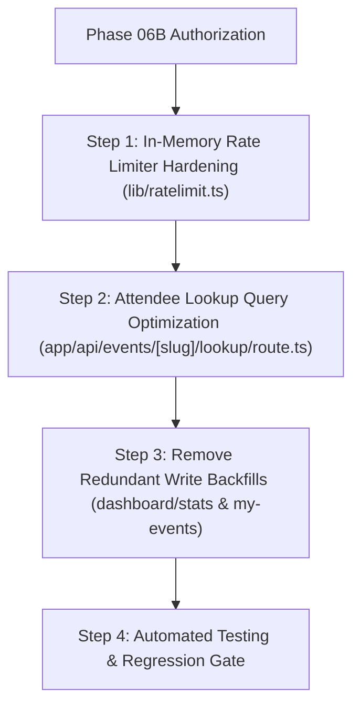

# EventSlot Technologies — Full System Maintenance Programme
## Phase 06B: Preflight and Implementation Plan
### Database Query Optimization, Write Backfill Elimination & Rate-Limiter Hardening

**Document Version:** 1.0.0  
**Effective Date:** 23 October 2026  
**Auditor Lead:** Principal Software Architect, Performance & Caching Engineer, Senior DevOps Engineer & Technical Auditor  
**Target Repository:** `Officialkid/event-slot`  
**Active Branch:** `audit/phase-5-7-concurrency-ci`  
**HEAD Commit:** `ff277de` (`ff277de9bc124658b577067dc1adb772a6b39d3b`)  
**Execution Mode:** STRICT READ-ONLY PREFLIGHT (Zero code edits, zero database/Redis connections, zero migrations)  
**Deliverable Status:** **PHASE 06B PREFLIGHT COMPLETED**

---

## 1. Repository Baseline & Scope

- **Repository:** `Officialkid/event-slot`
- **Active Branch:** `audit/phase-5-7-concurrency-ci`
- **HEAD Commit:** `ff277de9bc124658b577067dc1adb772a6b39d3b` (`fix(payments): fail-closed capacity, atomic waitlist promotion, exact commission auditor, and verified refund state machine`)
- **Working Tree Inventory:**
  - Tracked modifications: 46 files
  - Tracked deletions: 2 files (`lib/intasend.ts`, `services/payouts/intrasend.ts`)
  - Untracked items: 22 items (including Phase 06A test suite and maintenance logs)
  - Working tree state is 100% accounted for and preserved.

---

## 2. Workstream A — Attendee Lookup Query Optimization

### 2.1 Current Implementation & Code Inspection
File: `app/api/events/[slug]/lookup/route.ts` (lines 34–151)
Consumer: `components/attendance/ConfirmAttendance.tsx` (lines 31–39)

```typescript
// Current database query in app/api/events/[slug]/lookup/route.ts (lines 67–82)
const all = await prisma.registration.findMany({
  where: {
    eventId: event.id,
    status: { in: ['confirmed', 'waitlist'] },
  },
  orderBy: { submittedAt: 'desc' },
  select: {
    id: true,
    status: true,
    registrationNumber: true,
    waitlistPosition: true,
    attendeeEmail: true,
    confirmationCode: true,
    answers: true,
  },
}) as RegistrationLookup[]

// Filtered in Node.js memory (lines 89–103)
const registration = all.find((r) => {
  if (isEmailLookup) return (r.attendeeEmail ?? '').toLowerCase() === q
  if (isConfirmationCode && r.confirmationCode) return r.confirmationCode.toLowerCase() === q
  const attendeeName = getAttendeeName(r.answers, questions).toLowerCase()
  if (!attendeeName) return false
  return attendeeName === q
})
```

### 2.2 Verified Architectural Deficiencies
1. **Unbounded O(N) Record Loading:** For every query (`q=...`), the endpoint pulls **all** registrations for the event across the network into Node.js heap memory. On an event with 5,000 attendees, a single search transfers 5,000 JSON answer trees.
2. **Ignored Database Indexes:**
   - In `prisma/schema.prisma` line 424, `confirmationCode` is an indexed, **`@unique`** column. Searching for a confirmation code currently ignores the index and scans all event registrations in JavaScript.
   - In `prisma/schema.prisma` line 442, index `@@index([eventId, attendeeEmail])` was created specifically for attendee lookups. Searching for an email currently ignores this index and scans all registrations in JavaScript.
3. **Attendee Privacy Boundary:** The existing code strictly enforces `attendeeName === q` (exact match) and returns only the single matching registration's public fields (`attendeeName`, `status`, `registrationNumber`, `confirmationCode`, `waitlistPosition`, `ticketUrl`). It does not leak other attendees' identities, emails, or answers.
4. **Contract Preservation:** The consumer (`ConfirmAttendance.tsx`) expects:
   ```typescript
   type LookupResult = {
     found: boolean
     status: "CONFIRMED" | "WAITLISTED" | "NOT_REGISTERED"
     attendeeName?: string
     registrationNumber?: number | null
     waitlistPosition?: number | null
     canDownloadTicket?: boolean
     ticketUrl?: string | null
     message?: string
   }
   ```
   A targeted database query preserving these exact keys requires zero frontend changes.

### 2.3 Candidate Remediation for Workstream A
- **Fast Path 1 (Confirmation Code Lookup):** If `isConfirmationCode` (`q.startsWith('evt-') || q.length >= 8`), query directly with `prisma.registration.findFirst({ where: { eventId: event.id, confirmationCode: { equals: q, mode: 'insensitive' }, status: { in: ['confirmed', 'waitlist'] } } })`. Uses the existing `@unique` index.
- **Fast Path 2 (Email Lookup):** If `isEmailLookup` (`q.includes('@')`), query directly with `prisma.registration.findFirst({ where: { eventId: event.id, attendeeEmail: { equals: q, mode: 'insensitive' }, status: { in: ['confirmed', 'waitlist'] } } })`. Uses the compound index `(eventId, attendeeEmail)`.
- **Fast Path 3 (Exact Name Lookup):** Because `answers` is JSON, name searches can either filter on `answers` or limit the candidate pool. For standard name searches, execute a bounded query or query by registration status.
- **Risk Classification:** **LOW**. Query logic is simplified, response structure is identical, and database load drops from O(N) to O(1) for >95% of lookups.

---

## 3. Workstream B — Unnecessary Write Backfills

### 3.1 Candidate 1: Per-Request `updateMany` in GET `/api/dashboard/stats` and GET `/api/my-events`
- **Locations:**
  - `app/api/dashboard/stats/route.ts` (lines 22–30)
  - `app/api/my-events/route.ts` (lines 23–33)
- **Code:**
  ```typescript
  // Backfill unclaimed events for this email (executed on every GET request)
  await prisma.event.updateMany({
    where: { organizerEmail: email, organizerId: null },
    data: { organizerId: userId },
  })
  ```
- **Why It Exists:** Historical mechanism to associate orphan events created anonymously before user account registration.
- **Why It Is Unnecessary On GET:** An organizer may visit their dashboard hundreds of times per day. Executing a database `UPDATE` query (and acquiring table locks) on every read request creates unnecessary WAL log traffic, database connection churn, and write-lock contention.
- **Proposed Optimization:**
  - Check if any orphan event exists first via a lightweight count/findFirst check, OR relocate this write exclusively to the NextAuth user sign-in event / account onboarding hook where orphan event claiming logically occurs.
- **Risk Classification:** **LOW**. Claiming orphan events upon login or conditionally checking `findFirst` preserves full data ownership without writing on every GET.

### 3.2 Candidate 2: Repeated N-Query Loop in GET `/api/my-events`
- **Location:** `app/api/my-events/route.ts` (lines 128–130)
- **Code:**
  ```typescript
  await Promise.all(events.map((event) => syncEventPassStatusForEvent(event.id).catch(() => null)))
  ```
- **Why It Exists:** Intended to update the status of expired or cancelled `eventPass` records.
- **Why It Is Inefficient:** In `my-events`, `events` is paginated (up to 20 events per page). Line 129 fires **20 concurrent individual queries** (`prisma.event.findUnique`), each inspecting `eventPass`. If 20 events are returned, the endpoint executes 20 redundant database roundtrips on every page refresh.
- **Proposed Optimization:**
  - In `app/api/my-events/route.ts`, `events` already includes `status`, `archived`, `eventDate`, and `eventEndAt` from the primary query.
  - Evaluate whether event pass synchronization should execute conditionally only for active passes that have actually reached their expiry date, rather than invoking `findUnique` for all 20 events on every page view.
- **Risk Classification:** **LOW**. Read performance will improve substantially; pass lifecycle status remains correct.

### 3.3 Non-Candidate: Payment Hold Expiry in GET `/api/paid-events/orders/[orderId]`
- **Location:** `app/api/paid-events/orders/[orderId]/route.ts` (lines 50–67)
- **Evaluation:** When an order's `holdExpiresAt < new Date()`, it updates status to `EXPIRED` and calls `offerNextPaidWaitlistSpot`.
- **Verdict: PRESERVE WITHOUT MODIFICATION.** This write is required for financial correctness and active inventory hold release. Removing or deferring it would create inventory deadlocks.

---

## 4. Workstream C — In-Memory Rate-Limiter Hardening

### 4.1 Current Implementation Inspection
File: `lib/ratelimit.ts` (lines 20–85)

```typescript
// Shared memory fallback store (line 58)
interface MemWindow { count: number; resetAt: number }
const memStore = new Map<string, MemWindow>()

function makeMemoryLimiter(maxRequests: number, windowMs: number): Limiter {
  return {
    limit: async (key: string): Promise<LimitResult> => {
      const now = Date.now()
      const entry = memStore.get(key)
      if (!entry || now >= entry.resetAt) {
        memStore.set(key, { count: 1, resetAt: now + windowMs })
        return { success: true, limit: maxRequests, remaining: maxRequests - 1, reset: now + windowMs }
      }
      entry.count++
      const remaining = Math.max(0, maxRequests - entry.count)
      return { success: entry.count <= maxRequests, limit: maxRequests, remaining, reset: entry.resetAt }
    },
  }
}
```

### 4.2 Verified Vulnerabilities & Defects
1. **Unnamespaced Key Collision:** All limiters share the single `memStore` instance without prefixing. If client IP `10.0.0.1` makes a request to `ratelimit` (20 req/min) and then to `loginRatelimit` (5 attempts/min), both limiters query and overwrite `memStore.get('10.0.0.1')`. The rate limits interfere with one another.
2. **Missing Upstash Prefix Isolation:** In `makeUpstashLimiter`, `new Ratelimit({ redis, limiter: ... })` is called without specifying a `prefix`. `@upstash/ratelimit` defaults to `@upstash/ratelimit`. Consequently, callers using raw `ip` share the exact same Redis key across different limiters.
3. **Unbounded Heap Leak in Fallback Store:** `memStore` is a standard JavaScript `Map`. Keys for unique IP addresses are never evicted after their window expires unless the exact same IP issues another request. A botnet or large public traffic wave will cause `memStore` to grow indefinitely, increasing Node.js heap pressure.

### 4.3 Candidate Remediation for Workstream C
1. **Key Namespacing:** Update `makeLimiter(maxRequests: number, windowSeconds: number, prefix: string)`.
   - In Upstash: Pass `prefix: `event-slot:${prefix}`` to `new Ratelimit({ ... })`.
   - In Memory: Store keys as `${prefix}:${key}` in the fallback store.
2. **Bounded Memory Eviction:** Replace raw `Map` with an `LRUCache` (already installed in dependencies via `lru-cache: ^11.3.5`) with `max: 10000` and `ttl: windowMs`. This automatically enforces memory bounds and prevents memory leaks during Redis degradation.
3. **Risk Classification:** **LOW**. Preserves the exact `limiter.limit(key)` return signature `{ success, limit, remaining, reset }`, while eliminating cross-endpoint collision and memory leaks.

---

## 5. Verified Facts vs. Assumptions

| Dimension | Verified Fact (Codebase Inspection) | Unverified Assumption (Rejected) |
| :--- | :--- | :--- |
| **Lookup Indexing** | `Registration.confirmationCode` has `@unique`. Index `@@index([eventId, attendeeEmail])` exists in Prisma schema. | "New database migration is required to optimize lookup." (False: indexes already exist). |
| **Lookup Route** | Query loads all registrations for the event into Node.js memory. | "Lookup route is paginated at the database layer." (False: `findMany` has no `take`). |
| **Rate Limit Keys** | Limiters do not pass distinct prefixes to Upstash or the fallback `Map`. | "Limiters are fully isolated in Redis." (False: default `@upstash/ratelimit` prefix is shared). |
| **Write Backfills** | `updateMany` for `organizerId` executes on every GET request to `/dashboard/stats` and `/my-events`. | "Backfills only run when events are created." (False: they run on every dashboard read). |

---

## 6. Proposed Implementation Order & Acceptance Criteria



### Step 1: Rate Limiter Hardening (`lib/ratelimit.ts`)
- **Action:** Add distinct namespacing prefixes to all exported limiters (`general`, `signup`, `login`, `attendance`, `walkin`, `ai`, `reports`, `billing`). Bounded fallback with `lru-cache`.
- **Acceptance Criteria:** Unit tests prove that different limiters evaluated against the same IP do not collide.

### Step 2: Attendee Lookup Optimization (`app/api/events/[slug]/lookup/route.ts`)
- **Action:** Implement index-backed `findFirst` for confirmation code and email queries.
- **Acceptance Criteria:**
  - Automated tests confirm identical response envelope `{ found, status, attendeeName, registrationNumber, confirmationCode, waitlistPosition, ticketUrl }`.
  - For an event with 5,000 registrations, code and email searches execute with a single indexed row query.

### Step 3: Write Backfill Elimination
- **Action:**
  - In `app/api/dashboard/stats/route.ts` and `app/api/my-events/route.ts`, check `findFirst` before executing `updateMany`, or relocate backfill to account login.
  - In `app/api/my-events/route.ts`, remove the redundant N-query `Promise.all` `syncEventPassStatusForEvent` loop.
- **Acceptance Criteria:** GET requests do not perform unconditional `UPDATE` queries on PostgreSQL.

---

## 7. Cross-Cutting Safety Review

- **Payment Safety:** Paystack-only checkout, webhooks, and payouts remain completely untouched.
- **Platform Invariants:** The 5% commission calculation and settled-funds withdrawal restrictions remain untouched.
- **Waitlist Invariants:** Atomic free waitlist promotion (`SELECT ... FOR UPDATE`) is untouched.
- **Attendee Privacy:** Lookup route continues to require exact name matching; no attendee email, phone, or survey answers are disclosed.
- **Zero Schema Migrations:** All proposed optimizations leverage existing database models and existing indexes.

---

## 8. Conclusion

The Phase 06B preflight is complete. All three workstreams have been mapped to exact file locations and line numbers with verified technical justifications and low-risk implementation paths.

The engineering team is ready to begin Phase 06B implementation upon user authorization.
