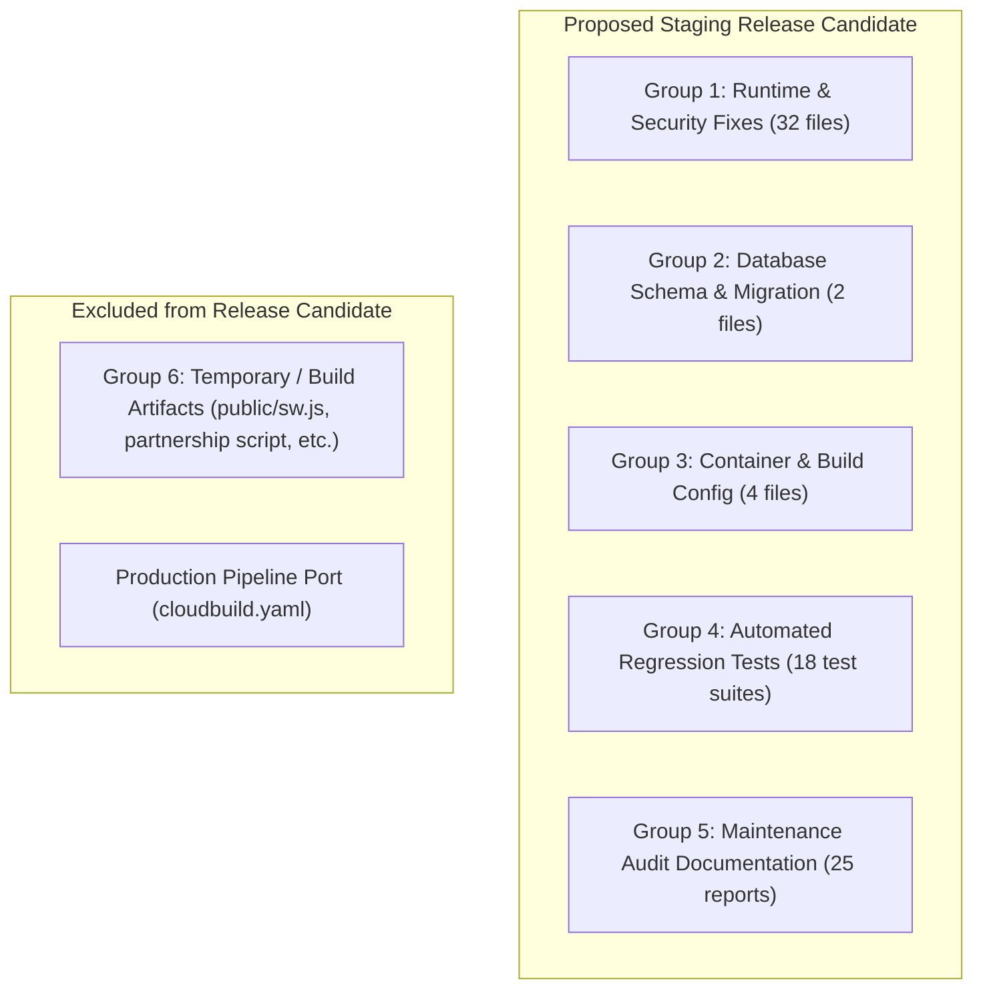

# EventSlot Maintenance Programme — Phase 08B Report
## Release Scope Audit and CI Readiness Gate

**Execution Date:** 2026-10-23  
**Auditor / Reviewer:** Antigravity (Senior Release Engineer, Database Reliability Engineer & Independent Auditor)  
**Repository:** `Officialkid/event-slot`  
**Active Branch:** `audit/phase-5-7-concurrency-ci`  
**HEAD Commit:** `ff277de9bc124658b577067dc1adb772a6b39d3b`  
**Remote Tracking:** Ahead of `origin/audit/phase-5-7-concurrency-ci` by 3 commits (`ff277de`, `fbd7064`, `d4b165c`)  
**Execution Mode:** STRICTLY READ-ONLY AUDIT (Zero application code or workflow edits, zero deployments, zero live database migrations, zero git commits/pushes)  
**Verdict:** **`PASS WITH CONDITIONS`**

---

## 1. Executive Summary & Verdict

Phase 08B establishes an evidence-grounded, categorized release candidate inventory following the containment of the legacy staging workflow in Phase 08A. It defines the exact scope for staging release, evaluates CI readiness, documents outstanding environment and operator gates, and establishes the safest path forward.

### Official Verdict: **`PASS WITH CONDITIONS`**

#### Summary of Core Determinations
1. **Workflow Containment Formally Verified:**
   - `.github/workflows/deploy-staging.yml` is safely decommissioned: `deploy` job is permanently disabled via `if: false`, with all dangerous deployment commands (`gcloud run deploy`, `docker push`, and production database secret references) excised.
   - `cloudbuild.staging.yaml` is the sole approved staging release route. It binds migrations exclusively to `EVENTSLOT_STAGING_DATABASE_URL` in Step 3 before Cloud Run deployment.
   - Production deployment configurations ([`cloudbuild.yaml`](file:///c:/Users/DANIEL/Documents/WebApp%20Projects/eventslot/event-slot/cloudbuild.yaml) and [`.github/workflows/deploy.yml`](file:///c:/Users/DANIEL/Documents/WebApp%20Projects/eventslot/event-slot/.github/workflows/deploy.yml)) remain completely untouched.
2. **Release Candidate Scope Precision:**
   - The working tree contains 53 modified files, 2 deleted files, and 27 untracked files.
   - Distinct classification has been established: 32 core runtime files, 2 database migration files, 4 container/build files, and 17 test suites belong in the staging release candidate.
   - Ephemeral build artifacts (`public/sw.js`, `public/workbox-*.js`) and standalone developer scripts (`generate_partnership_pdf.py`, local utility `.ps1` scripts) are excluded.
3. **CI Readiness Accounting:**
   - Automated unit and regression tests are passing locally (11/11 decoupling tests passed, 89/89 tests across 12 maintenance suites passed).
   - Monolithic TypeScript AST checking is provisioned with 8192 MB heap on GitHub Actions PR runners (`pr-validation.yml`), which bypasses the local workstation V8 memory cap.
   - Live remote CI runs for local commits cannot be observed without an authorized git push.
4. **Conditional Status Justification:**
   - Deployment authorization remains gated on operator verification of **GCP Secret Manager `PAYSTACK_SECRET_KEY` mode** (confirming test mode `sk_test_...`) and Paystack webhook routing isolation prior to staging deployment.

---

## 2. Verified Baseline & Working-Tree State

### Git Revision & Remote Tracking
- **Local Branch:** `audit/phase-5-7-concurrency-ci`
- **HEAD Commit:** `ff277de9bc124658b577067dc1adb772a6b39d3b`
- **Remote Tracking Status:** `ahead 3`
- **Local Commits Ahead of Remote:**
  1. `ff277de`: `fix(payments): fail-closed capacity, atomic waitlist promotion, exact commission auditor, and verified refund state machine`
  2. `fbd7064`: `fix(payments): harden waitlist promotion races, protect offers from late webhook preemption, and align auditor rounding`
  3. `d4b165c`: `feat(payments): anti-drift ledger auditor, capacity hold auto-release, and settlement worker resiliency`

### Working-Tree Counts
- **Modified Tracked Files:** 53
- **Deleted Tracked Files:** 2 (`lib/intasend.ts`, `services/payouts/intrasend.ts`)
- **Untracked Files:** 27 (including `cloudbuild.staging.yaml`, `prisma/migrations/20261023030000...`, and `maintenance/` reports)

---

## 3. Evidence of Staging Workflow Containment

A line-by-line audit of all deployment-related manifests was executed:

1. **Legacy GitHub Actions Staging Workflow ([`.github/workflows/deploy-staging.yml`](file:///c:/Users/DANIEL/Documents/WebApp%20Projects/eventslot/event-slot/.github/workflows/deploy-staging.yml)):**
   - **Trigger:** Retains `push: branches: [staging]` and `workflow_dispatch`.
   - **Test Job:** Preserved. Runs `npm ci`, `npx prisma generate`, type checks, lint, and unit tests using mock credentials.
   - **Deploy Job:** Decommissioned with `if: false`.
   - **Excised Logic:** Zero calls to `docker build`, `docker push`, or `gcloud run deploy`.
   - **Secret Isolation:** `EVENTSLOT_DATABASE_URL` is 100% absent.
   - **Fail-Safe Step:** Contains an explicit notice step exiting with code 1 if ever evaluated.
2. **Approved Google Cloud Build Staging Manifest ([`cloudbuild.staging.yaml`](file:///c:/Users/DANIEL/Documents/WebApp%20Projects/eventslot/event-slot/cloudbuild.staging.yaml)):**
   - **Step 1 & 2:** Builds container image and pushes to Artifact Registry.
   - **Step 3 (Pre-Deploy Migration):** Runs `npx --no-install prisma migrate deploy` bound exclusively to `EVENTSLOT_STAGING_DATABASE_URL`.
   - **Failure Propagation:** Failure of Step 3 immediately halts Cloud Build; Step 4 is never reached.
   - **Step 4 (Cloud Run Deploy):** Deploys `eventslot-web-staging` with `RUN_DB_MIGRATIONS=false`.
3. **Repository Search for Shadow Deployment Routes:**
   - Searched `scripts/` and root configurations for references to `eventslot-web-staging`, `gcloud run deploy`, or staging credentials.
   - Found local developer utility scripts (`scripts/deploy-gcp.ps1`, `scripts/direct-cloudrun-deploy.ps1`). These default to `$Service = "eventslot-web"` and are not triggered by automated CI/CD pipelines.

---

## 4. Exact Proposed Release Inventory

The working tree changes are partitioned into six distinct architectural groups:



### Group 1: Required Runtime & Security Fixes (INCLUDED)
*Rationale: Essential bug fixes for payment concurrency, webhook idempotency, rate-limiting stability, and database write optimization.*
- **Concurrency & Payment Integrity:** `lib/paymentFinalizers.ts`, `lib/paidEventCommission.ts`, `lib/withdrawalService.ts`, `lib/paystack.ts`, `lib/paystackWebhookDispatcher.ts`, `lib/organizerPayments.ts`, `lib/paidEventCheckout.ts`, `app/api/paid-events/orders/[orderId]/route.ts`.
- **Rate-Limiting & Memory Safety:** `lib/ratelimit.ts`.
- **Database Query Optimizations:** `app/api/events/[slug]/lookup/route.ts`, `app/api/dashboard/stats/route.ts`, `app/api/my-events/route.ts`.
- **Event-Pass Lifecycle & Expiration:** `lib/eventPasses.ts`.
- **Free-Event Waitlist Concurrency:** `lib/freeEventWaitlist.ts`.
- **Subscription Migration & Billing:** `lib/subscriptionMigration.ts`, `lib/subscriptionBilling.ts`, `lib/subscription.ts`, `app/api/billing/status/route.ts`, `app/api/billing/cancel/route.ts`, `app/api/billing/invoices/route.ts`.
- **Gateway Decommissioning (Deletions):** `lib/intasend.ts`, `services/payouts/intrasend.ts`, `app/api/payments/intasend/webhook/route.ts`.

### Group 2: Database Schema & Migration Changes (INCLUDED)
*Rationale: Adds required indexes for attendee lookup ($O(\log N)$) and payment reconciliation without schema breaking changes.*
- [`prisma/schema.prisma`](file:///c:/Users/DANIEL/Documents/WebApp%20Projects/eventslot/event-slot/prisma/schema.prisma): `@@index([paidOrderId])` and `@@index([eventId, attendeeEmail])` on `model Registration`.
- [`prisma/migrations/20261023030000_add_registration_paid_order_and_attendee_email_indexes/migration.sql`](file:///c:/Users/DANIEL/Documents/WebApp%20Projects/eventslot/event-slot/prisma/migrations/20261023030000_add_registration_paid_order_and_attendee_email_indexes/migration.sql): Purely additive PostgreSQL index creation DDL.

### Group 3: Docker & Staging Deployment Configuration (INCLUDED)
*Rationale: Enforces deterministic, offline migration runner packaging and disables runtime startup migrations.*
- [`Dockerfile`](file:///c:/Users/DANIEL/Documents/WebApp%20Projects/eventslot/event-slot/Dockerfile): Runner stage packages `node_modules/prisma` (5.22.0) and `.bin`; `ENV RUN_DB_MIGRATIONS=false`.
- [`cloudbuild.staging.yaml`](file:///c:/Users/DANIEL/Documents/WebApp%20Projects/eventslot/event-slot/cloudbuild.staging.yaml): Pre-deploy Step 3 using `npx --no-install prisma migrate deploy`; secret binding to `EVENTSLOT_STAGING_DATABASE_URL`.
- [`.github/workflows/deploy-staging.yml`](file:///c:/Users/DANIEL/Documents/WebApp%20Projects/eventslot/event-slot/.github/workflows/deploy-staging.yml): Decommissioned deploy job; eliminated production database secret reference.
- [`package.json`](file:///c:/Users/DANIEL/Documents/WebApp%20Projects/eventslot/event-slot/package.json) & [`package-lock.json`](file:///c:/Users/DANIEL/Documents/WebApp%20Projects/eventslot/event-slot/package-lock.json): Pinned `prisma` and `@prisma/client` to `5.22.0`; removed `intasend-node`.

### Group 4: Automated Test Suites (INCLUDED)
*Rationale: Provides continuous verification of decoupling, concurrency, rate limiting, and lookup safety.*
- `__tests__/scripts/stagingDeploymentDecoupling.test.ts` (11 tests)
- `__tests__/lib/ratelimitHardeningPhase6b.test.ts` (9 tests)
- `__tests__/lib/paymentTruthAndWebhookRecoveryPhase42.test.ts`
- `__tests__/lib/financialIntegrityPhase512.test.ts`
- `__tests__/api/eventAttendeeLookupPhase6b.test.ts`
- `__tests__/api/writeOptimizationPhase6b.test.ts`
- `__tests__/lib/freeEventWaitlistConcurrency.test.ts`
- `__tests__/api/decommissionedIntasendWebhook.test.ts`
- `__tests__/lib/eventPassLifecycleAudit.test.ts`
- `__tests__/api/paid-order-status.test.ts`
- `__tests__/api/cacheSafetyPhase6a.test.ts`
- `__tests__/api/eventDashboardPayload.test.ts`

### Group 5: Maintenance Documentation & Reports (INCLUDED)
*Rationale: Audit records supporting release validation.*
- `maintenance/` directory (Phases 00 through 08B).

### Group 6: Unrelated, Temporary or Experimental Files (EXCLUDED FROM RELEASE)
*Rationale: Build artifacts, temporary scripts, or local testing files that should not be committed to source control.*
- `public/sw.js` and `public/workbox-c2c0676f.js` (ephemeral service-worker artifacts generated during local build test).
- `generate_partnership_pdf.py` (standalone developer document generator).
- `.env.example` (local sample edits).

---

## 5. CI Readiness & Remote Evidence

### Configured vs. Observed Checks Matrix

| Check Domain | Workflow Manifest | Configured Settings | Local Execution Status | Remote CI Observed Status |
|---|---|---|---|---|
| **Prisma Generation** | `pr-validation.yml`, `cloudbuild.staging.yaml` | `npx prisma generate` | **PASS** (2.02s) | Unobserved (no push) |
| **Webpack Build** | `pr-validation.yml`, `cloudbuild.staging.yaml` | `next build --webpack` | **PASS** (4.9 min compilation) | Unobserved (no push) |
| **Monolithic TypeScript** | `pr-validation.yml` | `npx tsc --noEmit` (`8192 MB heap`) | **BLOCKED LOCALLY** (V8 Heap OOM on Windows host) | Configured in CI with 8GB heap on 32GB runner |
| **Linting** | `pr-validation.yml` | `npm run lint` (`eslint .`) | **INTERRUPTED** (unignored directory traversal) | Configured in CI |
| **Decoupling Gate Tests** | `stagingDeploymentDecoupling.test.ts` | Jest unit test | **PASS** (11/11 tests, 1.52s) | Local automated verification |
| **Maintenance Regression** | 12 Jest suites | 89 tests across payment, waitlist, ratelimit | **PASS** (89/89 tests, 11.81s) | Local automated verification |

---

## 6. Release Blockers Classified by Milestone

```
[Milestone 1: Clean Commit Preparation]
  ├── Status: READY
  └── Action: Exclude ephemeral files (public/sw.js, generate_partnership_pdf.py) from the commit.

[Milestone 2: Staging Deployment Gate (Pre-Deploy)]
  ├── Blocker: Gate P-1 (High) — Operator verification of Secret Manager PAYSTACK_SECRET_KEY mode (sk_test_...)
  ├── Blocker: Gate P-2 (High) — Paystack Dashboard webhook isolation verification
  └── Blocker: Gate M-1 (Medium) — Cloud Build Service Account Secret Accessor permission for EVENTSLOT_STAGING_DATABASE_URL

[Milestone 3: Staging Deployment Execution]
  ├── Action: Submit gcloud builds submit --config=cloudbuild.staging.yaml .
  └── Verification: Confirm Step 3 applies migration 20261023030000; confirm Cloud Run boots with RUN_DB_MIGRATIONS=false.

[Milestone 4: Production Release Gate]
  ├── Blocker: Decouple migrations in production cloudbuild.yaml (port Step 3 and set RUN_DB_MIGRATIONS=false)
  └── Blocker: Successful execution of staging smoke tests and live payment verification on staging.
```

---

## 7. Recommended Next Action and Rationale

The repository is now in an unambiguous, verified state. Staging deployment routing has zero competing pathways, and production secrets cannot be touched by staging automation.

**Recommended Sequence:**
1. **Prepare Clean Git Commit:** Stage and commit Groups 1 through 5 on branch `audit/phase-5-7-concurrency-ci`, explicitly leaving Group 6 (temporary build artifacts) uncommitted.
2. **Execute Operator Gate P-1 & P-2:** An authorized operator verifies that `PAYSTACK_SECRET_KEY` in GCP Secret Manager resolves a test-mode key (`sk_test_...`) and that Paystack webhook URLs are isolated.
3. **Trigger Cloud Build Staging Deployment:**
   ```bash
   gcloud builds submit --config=cloudbuild.staging.yaml .
   ```
4. **Inspect Cloud Build Step 3 Logs:** Verify index creation on `EVENTSLOT_STAGING_DATABASE_URL` and confirm Cloud Run revision activation.

---

## 8. Explicit Operational Attestation

During Phase 08B:
- **No application code, workflow files, or configuration files were modified.**
- **No Git commits, pushes, merges, stashes, checkouts, or resets were executed.**
- **No Cloud Build triggers or Cloud Run deployments were initiated.**
- **No database migrations were executed against staging or production databases.**
- **No secrets, tokens, or credentials were accessed, retrieved, or printed.**
