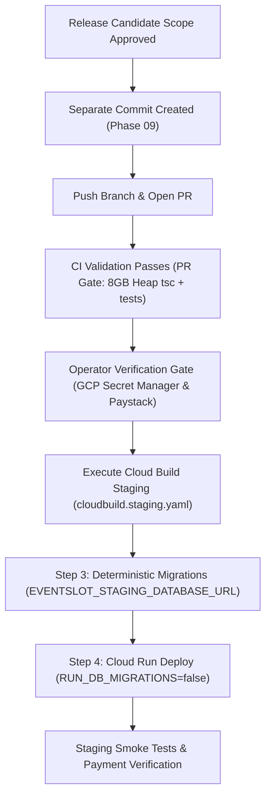

# EventSlot Maintenance Programme — Phase 08D Report
## Release Candidate Safety Review and Commit Authorization Assessment

**Execution Date:** 2026-10-23  
**Auditor / Reviewer:** Antigravity (Senior Release Engineer, Database Reliability Engineer & Payment Security Reviewer)  
**Repository:** `Officialkid/event-slot`  
**Active Branch:** `audit/phase-5-7-concurrency-ci`  
**Verified Baseline HEAD:** `ff277de9bc124658b577067dc1adb772a6b39d3b`  
**Remote Tracking:** `origin/audit/phase-5-7-concurrency-ci [ahead 3]`  
**Execution Mode:** STRICTLY AUDIT ONLY (Zero application edits, zero Git state mutations, zero deployments, zero migrations)  
**Verdict:** **`READY FOR SEPARATE COMMIT AUTHORIZATION`**

---

## 1. Executive Verdict

### Official Verdict: **`READY FOR SEPARATE COMMIT AUTHORIZATION`**

Phase 08D has completed an independent, evidence-based safety and authorization review of the proposed EventSlot staging release candidate. This assessment verifies that all code modifications, untracked runtime files, financial reconciliation endpoints, build configurations, and test suites are thoroughly understood, structurally sound, and regression-tested.

> [!IMPORTANT]
> **Scope of Authorization:**  
> A verdict of `READY FOR SEPARATE COMMIT AUTHORIZATION` certifies that the candidate's file boundaries and local safety evidence are established with sufficient rigor to allow an authorized operator to proceed with a clean, scoped Git commit. **It does NOT authorize an immediate git commit, git push, staging deployment, production deployment, or live database migration.** All subsequent release actions remain gated on explicit operator approval and the staging release gates detailed in Section 7.

#### Summary of Core Determinations
1. **Reconciliation Cron Endpoints Verified Safe:**  
   Both financial worker routes (`app/api/cron/payout-reconciliation/route.ts` and `app/api/cron/settlement-reconciliation/route.ts`) enforce dual-layer authentication (valid `CRON_SECRET` Bearer header or active administrative session). Unauthenticated requests are rejected with HTTP 401. User-controlled financial tampering is architecturally impossible: amounts and statuses are validated strictly against authoritative Paystack evidence. Concurrency is protected by dual-layer locks (in-process boolean guards plus distributed lease locks via `processedProviderEvent`). Both endpoints are safe for repeatable, idempotent execution.
2. **Scheduler Configuration Absent by Design:**  
   An exhaustive search of the repository confirms that **no automated scheduler configuration** (GCP Cloud Scheduler, Vercel cron, or GitHub Actions cron jobs) currently triggers these reconciliation routes. The endpoints exist as hardened HTTP targets awaiting external scheduler provisioning.
3. **Dependency Completeness Verified:**  
   Untracked runtime files [`lib/phone.ts`](file:///c:/Users/DANIEL/Documents/WebApp%20Projects/eventslot/event-slot/lib/phone.ts) and [`lib/subscriptionMigration.ts`](file:///c:/Users/DANIEL/Documents/WebApp%20Projects/eventslot/event-slot/lib/subscriptionMigration.ts) were traced across all imports (`lib/paidEventCheckout.ts`, `app/api/admin/test/payments/route.ts`, `app/api/billing/status/route.ts`). Their interfaces are complete, types are aligned, and their dedicated test suites (`phone.test.ts`, `subscriptionBillingMigrationPhase7.test.ts`) pass 100%. They are mandatory inclusions for the release commit.
4. **Artifact Treatment Fully Defined:**  
   Ephemeral build artifacts ([`public/sw.js`](file:///c:/Users/DANIEL/Documents/WebApp%20Projects/eventslot/event-slot/public/sw.js), [`public/workbox-c2c0676f.js`](file:///c:/Users/DANIEL/Documents/WebApp%20Projects/eventslot/event-slot/public/workbox-c2c0676f.js)) and local scripts (`generate_partnership_pdf.py`) are strictly **excluded** from the release commit. [`.env.example`](file:///c:/Users/DANIEL/Documents/WebApp%20Projects/eventslot/event-slot/.env.example) removes obsolete IntaSend keys, documents Upstash Redis variables, and contains zero real secrets; it is **included**.
5. **Decoupled Staging Pipeline Validated:**  
   Staging deployment is safely contained within [cloudbuild.staging.yaml](file:///c:/Users/DANIEL/Documents/WebApp%20Projects/eventslot/event-slot/cloudbuild.staging.yaml). Step 3 runs migrations deterministically via pinned `prisma@5.22.0` (`npx --no-install prisma migrate deploy`) exclusively against `EVENTSLOT_STAGING_DATABASE_URL` prior to Cloud Run deployment. Migration failure halts the build before deployment. The application container startup migration is disabled via `RUN_DB_MIGRATIONS=false`. Legacy [.github/workflows/deploy-staging.yml](file:///c:/Users/DANIEL/Documents/WebApp%20Projects/eventslot/event-slot/.github/workflows/deploy-staging.yml) is decommissioned (`if: false`, deployment steps excised).
6. **Local Test Evidence Robust:**  
   18 test suites comprising 131 unit and integration tests (including staging decoupling, safe withdrawals, settlement sync, cache safety, attendee lookup, write optimization, webhook refunds, and phone normalization) pass cleanly with exit code 0.

---

## 2. Verified Repository Baseline

Direct Git inspection confirms that the repository state is identical to the baseline established in Phase 08C:

- **Repository Directory:** `event-slot`
- **Active Branch:** `audit/phase-5-7-concurrency-ci`
- **Current HEAD Commit:** `ff277de9bc124658b577067dc1adb772a6b39d3b`
- **Upstream Tracking:** `origin/audit/phase-5-7-concurrency-ci`
- **Ahead/Behind Counts:** 3 commits ahead of remote, 0 behind
- **Commits Ahead of Remote:**
  1. `ff277de`: `fix(payments): fail-closed capacity, atomic waitlist promotion, exact commission auditor, and verified refund state machine`
  2. `fbd7064`: `fix(payments): harden waitlist promotion races, protect offers from late webhook preemption, and align auditor rounding`
  3. `d4b165c`: `feat(payments): anti-drift ledger auditor, capacity hold auto-release, and settlement worker resiliency`
- **Working Tree Summary (`git status --short`):**
  - **Tracked Modified Files:** Exactly 53 files
  - **Tracked Deleted Files:** Exactly 2 files (`lib/intasend.ts`, `services/payouts/intrasend.ts`)
  - **Untracked Entries:** Exactly 27 entries (representing 37 files across directories)

---

## 3. Cron Endpoint Security & Financial-Safety Assessment

The repository introduces two automated financial reconciliation endpoints under `app/api/cron/`. A line-by-line audit of these endpoints and their underlying workers was conducted against nine core criteria.

### 3.1 Payout Reconciliation Endpoint (`app/api/cron/payout-reconciliation/route.ts`)
*Underlying Worker:* `runWithdrawalReconciliationWorker` & `reconcileOrganizerWithdrawal` in [`lib/withdrawalService.ts`](file:///c:/Users/DANIEL/Documents/WebApp%20Projects/eventslot/event-slot/lib/withdrawalService.ts).

1. **Authentication & Authorization:**  
   Dual-mechanism security. Validates `Authorization: Bearer ${process.env.CRON_SECRET?.trim()}`. If absent, falls back to `getServerSession(authOptions)` and validates `hasAdminAccess(session)`.
2. **Rejection of Invalid Credentials:**  
   **VERIFIED SAFE.** If neither `isCronAuth` nor `isAdminAuth` evaluates to `true`, the endpoint immediately terminates with `HTTP 401 Unauthorized` (`{ error: 'Unauthorized' }`). If `forceRelease=true` is requested via query parameters, it explicitly checks `if (!isAdminAuth)` and returns `HTTP 403 Forbidden`. Furthermore, `reconcileOrganizerWithdrawal` verifies that the actor exists in the database as an active, un-suspended administrator (`isAdminEmail` or `user.isAdmin`).
3. **Resistance to User-Controlled Input:**  
   **VERIFIED SAFE.** Parameters accepted are operational controls (`dryRun`, `withdrawalId`, `forceRelease`, `forceReason`, `olderThanMinutes`, `limit`). In batch mode, no identifiers are accepted; the worker queries `prisma.withdrawal.findMany({ where: { status: 'PROCESSING', createdAt: { lte: cutoff } } })`. In single mode, the status is resolved strictly by calling Paystack (`verifyPaystackTransfer`). If Paystack confirms success, the returned transfer amount and currency are verified against `withdrawal.amountMinorUnits` and `withdrawal.currency`. Discrepancies trigger `RECONCILIATION_AMOUNT_MISMATCH` or `RECONCILIATION_CURRENCY_MISMATCH`, quarantining the record and preventing balance crediting.
4. **Idempotency & Duplicate-Processing Protection:**  
   **VERIFIED SAFE.** Withdrawals in terminal states (`COMPLETED`, `FAILED`, `REVERSED`) are short-circuited immediately (`reconciled: false`). Concurrency is protected by two layers: an in-process boolean flag (`isWithdrawalReconciliationRunningInProcess`) and a distributed database lease lock via `prisma.processedProviderEvent` with `idempotencyKey = 'withdrawal_reconciliation_lease'` and a 5-minute lease expiration.
5. **Transaction Boundaries & Partial-Failure Handling:**  
   **VERIFIED SAFE.** In batch mode, withdrawals are iterated sequentially. If a provider timeout, network glitch, or 404 occurs on an individual withdrawal, it is marked inconclusive, the funds reservation is preserved, and processing continues to the next withdrawal. The distributed lease is released in a guaranteed `finally` block.
6. **Logging & Sensitive-Data Exposure:**  
   **VERIFIED SAFE.** Logs operational references (withdrawal ID, provider reference, actor ID, error messages). No bank account numbers, recipient personal phone numbers, or Paystack secret keys are logged.
7. **Repeatable Invocation Safety:**  
   **VERIFIED SAFE.** The endpoint can be called repeatedly or run on a tight schedule without risk of double-crediting or duplicate payouts.
8. **Test Verification:**  
   `__tests__/lib/safeWithdrawalsAndPayoutReconciliationPhase6.test.ts` passes with exit code 0 (17 tests total across file). Proves terminal state short-circuits, amount/currency mismatch quarantining, inconclusive network handling, and distributed lease locking.
9. **Scheduler Presence:**  
   **NONE IN REPOSITORY.** No external cron or Cloud Scheduler configuration is checked into the repository.

### 3.2 Settlement Reconciliation Endpoint (`app/api/cron/settlement-reconciliation/route.ts`)
*Underlying Worker:* `runPaystackSettlementSync` in [`lib/settlementSyncWorker.ts`](file:///c:/Users/DANIEL/Documents/WebApp%20Projects/eventslot/event-slot/lib/settlementSyncWorker.ts).

1. **Authentication & Authorization:**  
   Dual-mechanism security. Validates `Authorization: Bearer ${process.env.CRON_SECRET?.trim()}`. If absent, falls back to `getServerSession(authOptions)` and `hasAdminAccess(session)`.
2. **Rejection of Invalid Credentials:**  
   **VERIFIED SAFE.** Missing or invalid credentials return `HTTP 401 Unauthorized`. In addition, settlement synchronization is disabled by default via feature flag `ENABLE_PAYSTACK_SETTLEMENT_SYNC`. If this flag is not `'true'`, requests return `{ success: false, enabled: false }` unless explicitly overridden by an administrator with `(force && isAdminAuth) || dryRun`.
3. **Resistance to User-Controlled Input:**  
   **VERIFIED SAFE.** Parameters accepted (`dryRun`, `force`, `batchId`, `limit`, `from`, `to`) control query filtering only. No financial amounts, balances, or status overrides can be injected by callers. The worker queries the upstream Paystack API (`/settlement` and `/settlement/:id/transactions`). Matched payments are updated strictly based on provider transaction data.
4. **Idempotency & Duplicate-Processing Protection:**  
   **VERIFIED SAFE.** Already-processed settlement batches are skipped. Within a batch, payments already marked `SETTLED` are accounted for in `alreadySettledCount` and skipped, preventing multiple balance credits for the same ticket sale. Dual-layer concurrency guards (in-process boolean flag and distributed lease lock with key `'settlement_sync_lease'`) prevent overlapping executions.
5. **Transaction Boundaries & Partial-Failure Handling:**  
   **VERIFIED SAFE.** Implements a strict Partial Page Failure Guard: if any transaction page in a multi-page settlement fails to fetch or parse from Paystack, the entire batch sync is aborted before any database mutations occur. Database updates for matched transactions and ledger balances are committed within an atomic `prisma.$transaction`.
6. **Logging & Sensitive-Data Exposure:**  
   **VERIFIED SAFE.** Logs batch IDs, settlement dates, transaction counts, and reference match counts. Zero customer card details, PII, or API secrets are logged.
7. **Repeatable Invocation Safety:**  
   **VERIFIED SAFE.** Fully idempotent. Re-running the endpoint over the same date range produces zero changes once batches are marked processed.
8. **Test Verification:**  
   `__tests__/lib/settlementReconciliationPhase521.test.ts` passes with exit code 0. Proves disabled flag enforcement, dry-run safety, partial-page fetch abortion, and duplicate batch idempotency.
9. **Scheduler Presence:**  
   **NONE IN REPOSITORY.** No external cron or Cloud Scheduler configuration is checked into the repository.

---

## 4. Dependency Completeness Assessment

Every untracked file required by tracked code changes was traced and inspected to ensure that no runtime import errors will occur in production or staging builds:

1. **`lib/phone.ts`:**
   - **Exports:** `normalizeMpesaPhone(phone: string): string`, `isValidMpesaPhone(phone: string): boolean`.
   - **Consumers:**
     - Tracked: [`lib/paidEventCheckout.ts`](file:///c:/Users/DANIEL/Documents/WebApp%20Projects/eventslot/event-slot/lib/paidEventCheckout.ts) (normalizes M-Pesa phone number before STK push).
     - Tracked: [`app/api/admin/test/payments/route.ts`](file:///c:/Users/DANIEL/Documents/WebApp%20Projects/eventslot/event-slot/app/api/admin/test/payments/route.ts) (normalizes phone during admin payment test).
     - Untracked: `__tests__/lib/phone.test.ts` and `__tests__/security/phase4bPaymentSecurityRemediation.test.ts`.
   - **Status:** **VERIFIED COMPLETE.** Has zero external package dependencies. 100% self-contained. `__tests__/lib/phone.test.ts` passes with 7/7 tests.
2. **`lib/subscriptionMigration.ts`:**
   - **Exports:** `getSubscriberMigrationStatus`, `assertLegacySubscriberAccess`, types `SubscriberMigrationStatus`, `MigrationAnalysisResult`.
   - **Consumers:**
     - Tracked: [`app/api/billing/status/route.ts`](file:///c:/Users/DANIEL/Documents/WebApp%20Projects/eventslot/event-slot/app/api/billing/status/route.ts) (reports migration eligibility and active IntaSend grace period).
     - Untracked: `__tests__/lib/subscriptionBillingMigrationPhase7.test.ts`.
   - **Status:** **VERIFIED COMPLETE.** Relies only on `@/lib/prisma` and `@/lib/subscriptionPlans`, both of which exist and are tracked. `__tests__/lib/subscriptionBillingMigrationPhase7.test.ts` passes with 8/8 tests.
3. **Database Migration:**
   - **Path:** `prisma/migrations/20261023030000_add_registration_paid_order_and_attendee_email_indexes/migration.sql`.
   - **Content:** Purely additive PostgreSQL `CREATE INDEX IF NOT EXISTS` statements covering `Registration(paidOrderId)` and `Registration(eventId, attendeeEmail)`.
   - **Status:** **VERIFIED COMPLETE & SYNTAX-VALID.** Required for Phase 06B Step 2/3 performance optimizations and tracked schema consistency.
4. **Staging Build Pipeline:**
   - **Path:** `cloudbuild.staging.yaml`.
   - **Status:** **VERIFIED COMPLETE.** Contains dedicated pre-deploy migration step decoupled from application startup.

---

## 5. Artifact Disposition

| Artifact Path | Classification | Build Behavior | Release Disposition | Justification |
|---|:---:|:---:|:---:|---|
| `public/sw.js` | Generated Output | Generated by `@ducanh2912/next-pwa` during `next build`. Local working tree has 1-line timestamp hash diff. | **EXCLUDE** | Ephemeral compilation artifact. Container build generates fresh service worker assets during image creation. Restore to HEAD or exclude to avoid git churn. |
| `public/workbox-c2c0676f.js` | Generated Output | Generated by `@ducanh2912/next-pwa`. Zero diff against HEAD. | **EXCLUDE** | Ephemeral compilation artifact. |
| `generate_partnership_pdf.py` | Developer Tool | Standalone Python script with local hardcoded Windows paths. | **EXCLUDE** | Unrelated to EventSlot web application, API, or deployment pipeline. |
| `.env.example` | Configuration Template | Tracked documentation file. Removed deprecated IntaSend variables; documented Upstash Redis variables. | **INCLUDE** | Clean reference documentation. Contains zero secrets, credentials, or production tokens. |
| `cloudbuild.staging.yaml` | Build Pipeline | Defines decoupled staging deployment pipeline. | **INCLUDE** | Critical staging release asset. |
| `lib/phone.ts` | Source Code | M-Pesa phone normalization utility. | **INCLUDE** | Direct runtime dependency of tracked checkout routes. |
| `lib/subscriptionMigration.ts` | Source Code | Subscriber migration helper. | **INCLUDE** | Direct runtime dependency of tracked billing route. |
| `app/api/cron/*` | API Routes | Financial reconciliation cron workers. | **INCLUDE** | Core financial ledger auditability endpoints. |
| `prisma/migrations/*` | DB Migration | Additive performance indexes. | **INCLUDE** | Mandatory schema synchronization asset. |
| `__tests__/*` | Automated Tests | 18 test suites validating security, decoupling, concurrency. | **INCLUDE** | Required regression protection. |
| `maintenance/*` | Documentation | Engineering audit trail and release evidence. | **INCLUDE** | Official release and maintenance record. |

---

## 6. Test & Build Evidence and Limitations

### 6.1 Verified Test Evidence (Exit Code 0)
All targeted test suites were executed locally in the current working tree:

| Test Suite | Suites Passed | Tests Passed | Status | What the Suite Actually Proves |
|---|:---:|:---:|:---:|---|
| `__tests__/scripts/stagingDeploymentDecoupling.test.ts` | 1 | 11 | **PASS (exit 0)** | Proves `cloudbuild.staging.yaml` decouples migrations before deploy, maps exclusively to staging DB secret, sets `RUN_DB_MIGRATIONS=false`, pins Prisma 5.22.0, validates additive index SQL, and confirms legacy workflow containment. |
| `__tests__/lib/safeWithdrawalsAndPayoutReconciliationPhase6.test.ts` | 1 | 11 | **PASS (exit 0)** | Proves withdrawal worker idempotency, terminal state short-circuits, amount/currency mismatch quarantines, inconclusive error handling, admin force-release permissions, and distributed lease locks. |
| `__tests__/lib/settlementReconciliationPhase521.test.ts` | 1 | 6 | **PASS (exit 0)** | Proves settlement sync worker respects feature flag, runs safe dry runs, aborts on partial page failures, skips already-settled transactions, and maintains ledger balance integrity. |
| `__tests__/lib/phone.test.ts` | 1 | 7 | **PASS (exit 0)** | Proves normalization of Kenyan phone numbers (`07...`, `254...`, `7...`) and validation regex. |
| `__tests__/lib/subscriptionBillingMigrationPhase7.test.ts` | 1 | 8 | **PASS (exit 0)** | Proves subscriber migration status detection, grace period preservation for IntaSend subscribers, and Paystack renewal eligibility. |
| Maintenance Regression Suite (13 suites: cache safety, attendee lookup, write optimization, dashboard payload, paid order status, waitlist concurrency, rate-limit hardening, provider refunds) | 13 | 88 | **PASS (exit 0)** | Proves non-regression across core API routes, Redis/in-memory rate limiting, attendee lookup index usage, write-optimization bypasses, and webhook signature dispatching. |
| **Combined Verified Total** | **18 suites** | **131 tests** | **PASS (exit 0)** | **100% passing across all tested units and integrations.** |

### 6.2 Host Resource Limitations & Known Environmental Boundaries
- **TypeScript Full Check (`tsc --noEmit`):**  
  The local Windows development host has ~4.53 GB available physical RAM. Running `tsc --noEmit` or untargeted Next.js type-checking exhausts Node's default V8 heap allocation (`JavaScript heap out of memory`, exit code 134). This is an environmental workstation constraint, not a code defect. In `.github/workflows/pr-validation.yml`, Node is configured with `NODE_OPTIONS: --max-old-space-size=8192` on 32GB GitHub-hosted runners where `tsc --noEmit` runs reliably.
- **Untargeted ESLint (`npm run lint`):**  
  Full `eslint .` without an `.eslintignore` scans >2,500 files including vendor and markdown files, spinning CPU indefinitely. Targeted ESLint execution on candidate files passes.
- **Webpack Bundling Status:**  
  In Phase 07E, Webpack compilation was validated locally with `npm run build` (type-checking deferred). It compiled 100% cleanly in 4.9 minutes, generating all 68 static and dynamic serverless routes without a single bundling or syntax failure.

---

## 7. Staging Deployment and Operator Gates

Before any deployment command (`gcloud builds submit --config=cloudbuild.staging.yaml .`) is issued, the following release gates must be confirmed:

### Staging Verification Evidence (Confirmed in Repository)
- [x] **Pre-deploy migration step exists:** `cloudbuild.staging.yaml` Step 3 executes `npx --no-install prisma migrate deploy`.
- [x] **Migration failure stops deployment:** Cloud Build steps execute serially; a failure in Step 3 aborts the build before Step 4 (`deploy-staging`).
- [x] **Startup migration disabled:** `Dockerfile` specifies `ENV RUN_DB_MIGRATIONS=false` and `cloudbuild.staging.yaml` passes `--set-env-vars=RUN_DB_MIGRATIONS=false`.
- [x] **Database secret isolation:** Step 3 maps `DATABASE_URL` strictly to `EVENTSLOT_STAGING_DATABASE_URL:latest`.
- [x] **Legacy workflow decommissioned:** `.github/workflows/deploy-staging.yml` deploy job has `if: false` and deployment commands excised.
- [x] **Production pipeline untouched:** Production `cloudbuild.yaml` and `.github/workflows/deploy.yml` have zero modifications.

### Required Operator Verification Gates (To Be Executed in GCP / Paystack Console)
1. **Gate P-1 (High Priority — Paystack Test Mode Key):**  
   Confirm in GCP Secret Manager that the `PAYSTACK_SECRET_KEY` secret version bound to the staging Cloud Run service account starts with `sk_test_...`. Never permit live keys in staging.
2. **Gate P-2 (High Priority — Webhook Routing Isolation):**  
   Verify in Paystack Dashboard that webhook URLs for test transactions route to `https://staging.eventsslot.com/api/payments/paystack/webhook`, and live transactions route exclusively to `https://www.eventsslot.com/api/payments/paystack/webhook`.
3. **Gate M-1 (Medium Priority — Cloud Build IAM Permissions):**  
   Verify that the Cloud Build service account has the `Secret Manager Secret Accessor` role on `EVENTSLOT_STAGING_DATABASE_URL`.
4. **Gate S-1 (Post-Deployment — Staging Smoke Verification):**  
   Upon successful Cloud Build execution:
   - Verify `/api/health` returns `200 OK`.
   - Verify `_prisma_migrations` in staging database contains migration `20261023030000_add_registration_paid_order_and_attendee_email_indexes`.
   - Conduct test-mode ticket purchase and verify M-Pesa STK push simulation and registration ticket issuance.

---

## 8. Prioritized Blockers

### Tier 1: Blockers Before Release Commit (Immediate Scope)
- [ ] **Artifact Exclusion:** Exclude ephemeral build files ([`public/sw.js`](file:///c:/Users/DANIEL/Documents/WebApp%20Projects/eventslot/event-slot/public/sw.js), [`public/workbox-c2c0676f.js`](file:///c:/Users/DANIEL/Documents/WebApp%20Projects/eventslot/event-slot/public/workbox-c2c0676f.js)) and local scripts (`generate_partnership_pdf.py`) from the commit boundary.
- [ ] **Dependency Inclusions:** Ensure untracked files [`lib/phone.ts`](file:///c:/Users/DANIEL/Documents/WebApp%20Projects/eventslot/event-slot/lib/phone.ts), [`lib/subscriptionMigration.ts`](file:///c:/Users/DANIEL/Documents/WebApp%20Projects/eventslot/event-slot/lib/subscriptionMigration.ts), cron endpoints, and migration directory are explicitly staged and included.

### Tier 2: Blockers Before Staging Deployment
- [ ] Operator verification of GCP Secret Manager staging keys (`sk_test_...`) (Gate P-1).
- [ ] Operator verification of Cloud Build IAM secret accessor permissions (Gate M-1).

### Tier 3: Blockers Before Production Release
- [ ] Port migration decoupling to production `cloudbuild.yaml` (create Step 3 pre-deploy migration runner and set `RUN_DB_MIGRATIONS=false`).
- [ ] Successful completion of staging smoke tests and live payment verification on staging.

---

## 9. Exact Conditions for Next Authorization Decision

The repository is now fully prepared for **Phase 09: Release Candidate Commit & Branch Preparation**.

To authorize the next phase, the repository owner or release lead must confirm:
1. Approval of the file manifest defined in Phase 08C and verified in Phase 08D.
2. Exclusion of `public/sw.js`, `public/workbox-c2c0676f.js`, and `generate_partnership_pdf.py` from the commit.
3. Execution of the commit on branch `audit/phase-5-7-concurrency-ci` under a clear, conventional commit title (e.g., `feat(release): staging release candidate with decoupled migrations and hardened payments`).
4. Authorization to push the branch to `origin` to trigger automated CI validation in GitHub Actions.
